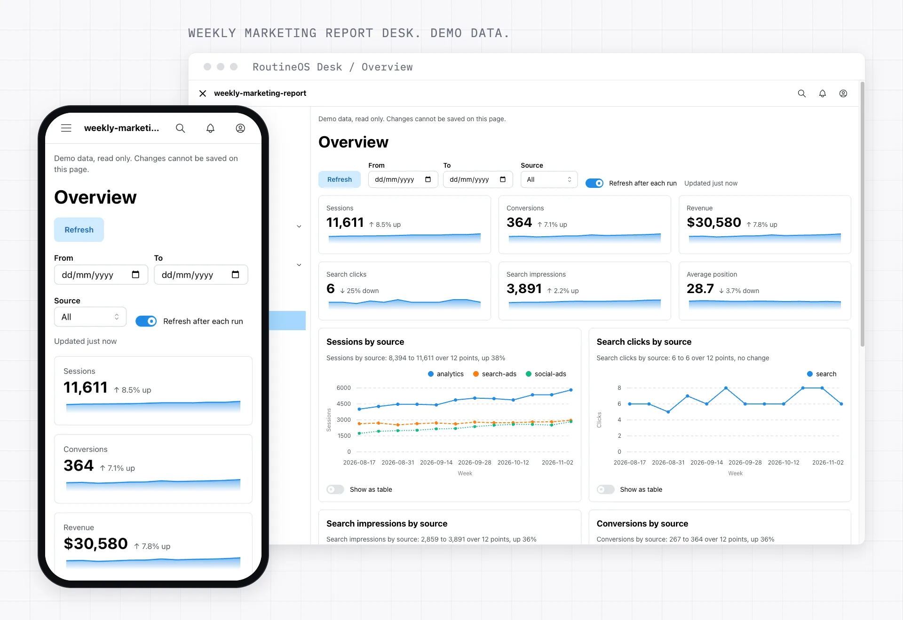
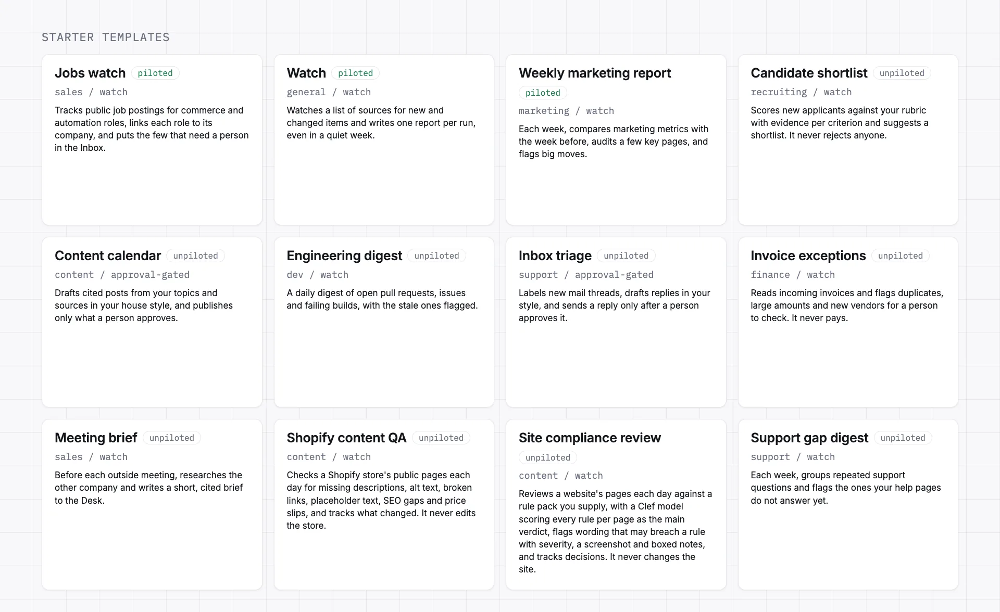

# RoutineOS: the self-improving framework for Claude routines

[](LICENSE)

RoutineOS is the self-improving framework for Claude routines, the scheduled Claude agents that do recurring work in the cloud. It learns from what it sees and what you decide, proposes each change with its source, and changes nothing until you say yes. It is for anyone who runs the same judgment task every week (triage, a watch, a report, a shortlist), and it gives each routine typed settings, a linter, templates, approval gates and a mobile Desk.

<picture><source media="(prefers-color-scheme: dark)" srcset=".github/assets/readme/desk-dark.webp"></picture>

- Home: [routineos.org](https://routineos.org)
- Docs: [docs.routineos.org](https://docs.routineos.org) (source: [devkindhq/routineos-docs](https://github.com/devkindhq/routineos-docs))
- Docs MCP server: `https://docs.routineos.org/api/mcp`

It runs on the Claude plan you already pay for, and RoutineOS itself is free (MIT).

## How it learns

A routine learns from what it sees (a list item that matched nothing for ten runs, runs that hit a limit) and from what you decide on the Desk (records you keep that a setting dropped, or drop that it kept). Code does the counting. When the pattern holds, one suggestion lands in your Inbox, such as "Add hydrogen to title_keywords", with the signal and evidence count. You accept, reject or snooze it. A routine never applies its own suggestion. See [Learning](https://docs.routineos.org/concepts/learning).

## What you get

- **Safe by default.** First runs are report-only, nothing sends, posts or deletes without an approval gate, and fetched content is data.
- **Conventions.** `new --type` scaffolds a `serverless`, `watch`, `approval-gated` or `interactive` routine, and the linter fails on a setting with no default, a schedule faster than hourly, or a prompt without the untrusted-data clause.
- **The Desk.** One private page per workspace shows what was kept, what was dropped and why, every run, and open approvals.
- **Templates and migration.** Install a routine from a pack, or convert an n8n workflow, Windmill flow or described Zap with `routineos migrate`.

Rails, Django and Laravel gave web apps a shape. RoutineOS borrows the shape, not the code:

| RoutineOS | Rails | Django | Laravel |
|---|---|---|---|
| Routine type | app template | project template | starter kit |
| Records and Store | models, database | models, ORM | Eloquent |
| Settings | config, credentials | settings | config, .env |
| Producers | jobs | management commands | queued jobs |
| Gates | before_action, approvals | permissions, admin actions | policies, gates |
| Desk | views | templates | Blade views |
| CLI | rails g, console | manage.py | artisan |

## Quick start

Install the Claude Code plugin in Claude Code 2.1.275 or later:

```
/plugin install routineos --marketplace devkindhq/routineos
```

The CLI needs Python 3.11 or newer (standard library only). From the repo root:

```
python3 skills/routineos/scripts/routineos.py doctor
python3 skills/routineos/scripts/routineos.py new my-watch --type watch
python3 skills/routineos/scripts/routineos.py lint my-watch
```

The [Quickstart](https://docs.routineos.org/introduction/quickstart) builds a full example routine, Desk included.

## Templates

<picture><source media="(prefers-color-scheme: dark)" srcset=".github/assets/readme/templates-dark.webp"></picture>

Each template is one pack file listed in `catalog/index.json`. Piloted means a real run checked it. Digest and tracker starters are coming soon.

- candidate-shortlist: unpiloted, watch
- content-calendar: unpiloted, approval-gated
- engineering-digest: unpiloted, watch
- inbox-triage: unpiloted, approval-gated
- invoice-exceptions: unpiloted, watch
- jobs-watch: piloted, watch
- meeting-brief: unpiloted, watch
- support-gap-digest: unpiloted, watch
- watch: piloted, watch
- weekly-marketing-report: unpiloted, watch

```
python3 skills/routineos/scripts/routineos.py pack list catalog/index.json
python3 skills/routineos/scripts/routineos.py pack install catalog/meeting-brief.json --dir my-brief
```

Write your own: [authoring](skills/routineos/references/authoring.md), [pack keys](skills/routineos/references/pack-schema.md).

## Honest limits

Claude scheduled tasks are a research preview and may change.

- Each run starts on a fresh Python 3.11 sandbox and cannot fire another routine: pilot-verified.
- Approval gates over email, and Slack sends with the connector set to "Ask for approval": pilot-verified.
- The artifact database holds 25,000 documents per artifact, 256 KiB each: pilot-verified, though the official artifact docs say artifacts have no backend.
- Minimum schedule interval is one hour: docs-stated, enforced by lint.
- "Run now" from the Desk has no low-latency path; it is an action queue: docs-stated.
- Repo-hosted scripts run inside a run when called by path: owner-verified. A script writing to the Desk db or a connector is unverified, so the model does every write.
- The API trigger (webhook) fires a routine from outside Claude: owner-verified. That the fire text reaches the run as untrusted data is docs-stated.
- Sheet or Drive writes need the Google Drive connector: unverified.
- Workers AI called directly from a run is blocked by the sandbox: pilot-verified. Through a connector: unverified.

## Docs

- [How it compares](https://docs.routineos.org/introduction/comparison): next to Rails, Django and Laravel, and next to automation tools
- [Honest limits](https://docs.routineos.org/introduction/honest-limits): every platform claim with its tag
- [Contributing](CONTRIBUTING.md)

### Docs inside Claude

The docs and the template catalog are also a free MCP server, so Claude can read them while it builds a routine with you. No account, no sign in, read only.

Claude Code: installing the plugin connects it for you. Without the plugin:

```sh
claude mcp add --transport http routineos https://docs.routineos.org/api/mcp
```

Add `--scope project` to commit it to the repo's `.mcp.json`, so cloud scheduled routines and everyone on the repo get it too.

Claude (web and Claude Desktop): **Customize > Connectors**, **+ Add**, **Add custom connector**, name it `RoutineOS`, paste `https://docs.routineos.org/api/mcp`, choose **No sign in**, then **Add**. Turn it on in a chat from **+ > Connectors**. Free plans allow one custom connector; on Team and Enterprise an owner adds it under **Organization settings > Connectors**.

Then ask Claude things like "search the RoutineOS docs for gates" or "set up the jobs watch template". Tools and details: [The RoutineOS MCP](https://docs.routineos.org/mcp).

## Licence

MIT, Devkind, 2026. Built by Devkind.
